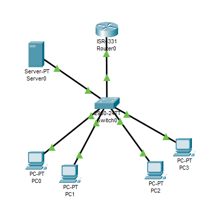
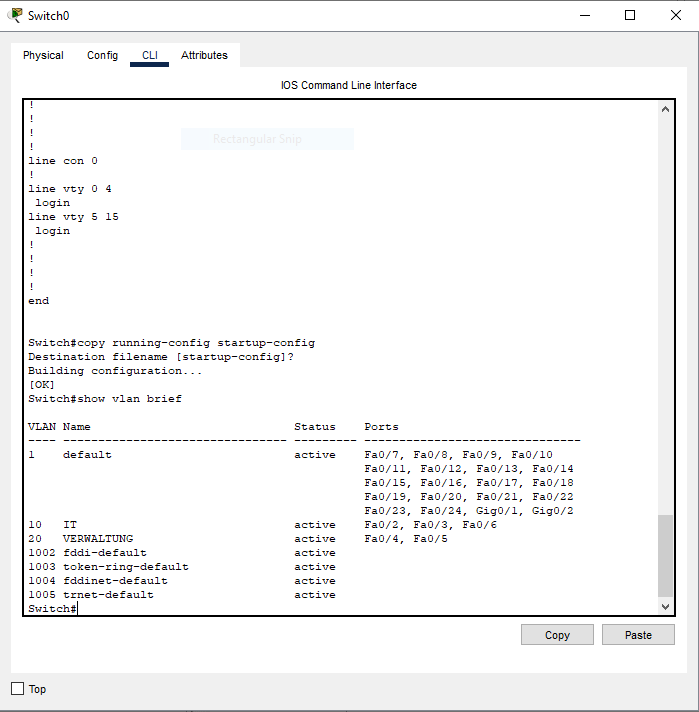
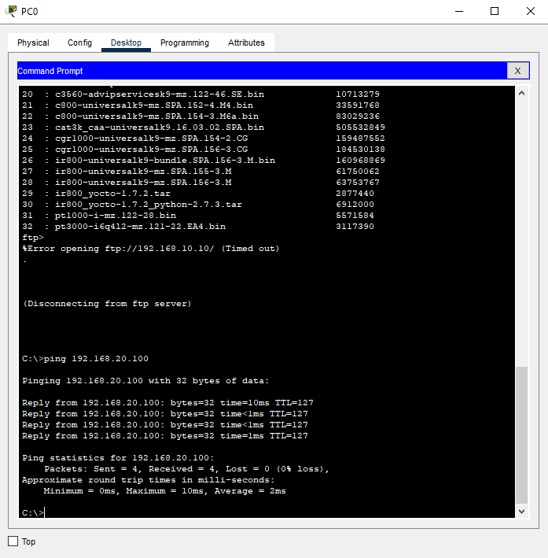

# Unternehmensnetzwerk mit Cisco Packet Tracer

## Projektübersicht

Dieses persönliche Lernprojekt umfasst den Aufbau und die Konfiguration eines simulierten Unternehmensnetzwerks mit Cisco Packet Tracer.

Das Netzwerk besteht aus einem Router, einem Layer-2-Switch, vier PCs und einem FTP-Server. Es ist in zwei VLANs unterteilt, um die Netzwerkbereiche IT und Verwaltung logisch voneinander zu trennen.

## Verwendete Technologien

- Cisco Packet Tracer
- VLAN (Virtual Local Area Network)
- IPv4 und Subnetting
- IEEE 802.1Q
- Router-on-a-Stick
- Inter-VLAN-Routing
- DHCP
- FTP

## Netzwerkübersicht

| VLAN | Name | Subnetz | Gateway |
|---|---|---|---|
| 10 | IT | 192.168.10.0/24 | 192.168.10.1 |
| 20 | Verwaltung | 192.168.20.0/24 | 192.168.20.1 |

**FTP-Server:** 192.168.10.10  
**DHCP:** Separate DHCP-Pools für beide VLANs

## Implementierte Funktionen

- Einrichtung der VLANs 10 und 20
- Konfiguration eines 802.1Q-Trunks zwischen Switch und Router
- Inter-VLAN-Routing mit Router-on-a-Stick
- Automatische IP-Adressvergabe über DHCP
- Konfiguration eines FTP-Servers mit statischer IPv4-Adresse
- Dokumentation der Router- und Switch-Konfiguration

## Funktionstests

- Ping zwischen Clients in unterschiedlichen VLANs
- Überprüfung der DHCP-Adressvergabe
- Ping zum FTP-Server aus VLAN 20
- Verbindung zum FTP-Server und Überprüfung des Dateizugriffs

Die beschriebenen Funktionstests wurden im Rahmen der Simulation durchgeführt.

## Projektdateien

- `Unternehmensnetzwerk.pkt` – Packet-Tracer-Projektdatei.pkt` – Packet-Tracer-Projektdatei
- `Router_Config.txt` – Router-Konfiguration und Befehlsausgaben
- `Switch_Config.txt` – Switch-Konfiguration und Befehlsausgaben
- `Netzwerkdokumentation.txt` – Technische Dokumentation

## Ziel des Projekts

Ziel dieses persönlichen Lernprojekts ist es, praktische Kenntnisse in Netzwerktechnik, VLAN-Konfiguration, IP-Adressierung, Routing und Netzwerkdiensten aufzubauen und zu vertiefen.

**Projektart:** Persönliches Lernprojekt  
**Software:** Cisco Packet Tracer
## Screenshots

### 1. Network Topology

### 2. VLAN Configuration

### 3. Inter-VLAN Routing Test

### 4. FTP Server Access

